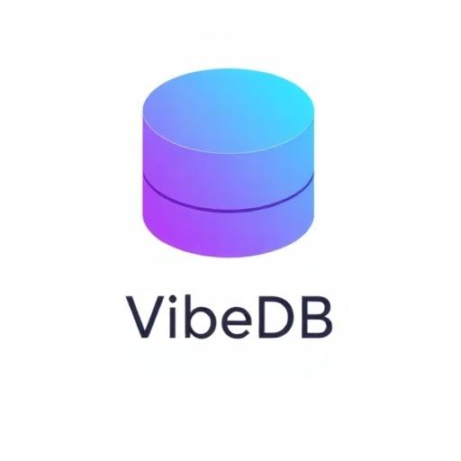

<p align="center">
  
</p>

<h1 align="center">VibeDB</h1>

<p align="center">
  <strong>Design databases visually. Deploy instantly.</strong>
  <br />
  The AI-powered database schema designer that turns your ideas into production-ready schemas in seconds.
</p>

<p align="center">
  <a href="#features">Features</a> &bull;
  <a href="#getting-started">Get Started</a> &bull;
  <a href="#tech-stack">Tech Stack</a> &bull;
  <a href="#project-structure">Project Structure</a>
</p>

---

## Why VibeDB?

Building a database schema shouldn't require memorizing DDL syntax or drawing ER diagrams on a whiteboard. **VibeDB** lets you design your entire database visually on an interactive canvas, supercharged with AI that understands what you're building.

- **Describe your app in plain English** — VibeDB generates the schema for you
- **Drag, drop, and connect** tables on an infinite canvas
- **Export production-ready code** in SQL, Prisma, Drizzle, or GraphQL
- **Deploy to Supabase** with a single click — no copy-pasting SQL

---

## Features

### Visual Canvas Designer
Design your schema the way you think about it — visually.

- **Infinite canvas** with pan, zoom, and drag-and-drop
- **Auto-layout** arranges tables automatically with one click
- **FK relationship lines** drawn as smooth bezier curves between tables
- **Full undo/redo** history (Ctrl+Z / Ctrl+Y)

### Complete Schema Modeling
Everything you need for production-grade schemas.

- **10+ column types** — `uuid`, `varchar`, `text`, `int`, `numeric`, `decimal`, `float`, `timestamp`, `boolean`, `jsonb`, custom enums
- **Constraints** — primary keys, not-null, unique, defaults
- **Foreign keys** — visual creation with status tracking and deferrable support
- **Indexes** — standard, unique, and partial indexes with `WHERE` clauses
- **Check constraints** — custom validation expressions
- **Enum types** — `CREATE TYPE` for categorical data
- **Functions & triggers** — `CREATE OR REPLACE FUNCTION` with `$$` block support

### AI Superpowers
Powered by **Anthropic Claude** — the AI doesn't just suggest, it builds.

| | Feature | What it does |
|---|---------|-------------|
| **Generate** | Schema Generation | Describe your app → get a complete, normalized database schema |
| **Edit** | Batch Commands | "Add soft delete to all tables" — done in one command |
| **Suggest** | Smart Columns | AI recommends columns based on your table's context |
| **Audit** | Schema Audit | Get a quality score (0-100) with a detailed rubric and actionable fix suggestions |
| **Chat** | AI Assistant | Have a conversation about your schema — brainstorm, refine, and apply changes |
| **Query** | Query Generation | Describe what you want → get the SQL query |
| **Seed** | Mock Data | Generate realistic INSERT statements that respect FK relationships |

### Export Anywhere
Generate production-ready code in the format your stack needs.

- **SQL** — PostgreSQL DDL with tables, indexes, constraints, enums, and functions
- **Prisma** — Complete schema with models, relations, and type mappings
- **Drizzle** — TypeScript ORM definitions ready to drop into your project
- **GraphQL** — Type definitions for your API layer
- **CSV** — Table and column metadata for documentation

### One-Click Deploy to Supabase
Go from design to production in seconds.

- Connect your Supabase project with URL + service role key
- **Pre-deploy validation** catches issues before they hit your database
- **Smart FK ordering** — tables created in dependency order
- **Idempotent** — re-deploy safely without "already exists" errors
- **DEFERRABLE constraints** — foreign keys use `DEFERRABLE INITIALLY DEFERRED`
- **Dollar-quote aware** — functions with `$$` blocks deploy correctly

### Schema Quality Tools
Ship with confidence.

- **AI Audit** — Detailed scoring rubric: -15 for missing PKs, -5 for missing indexes, -3 for naming violations, and more
- **Deduplication** — One-click cleanup of duplicate indexes and columns
- **Linting** — Automatic naming convention validation
- **Schema Diff** — Snapshot your schema and compare changes over time
- **Auto-fix** — Detect and resolve issues before deployment

### Project Management
Never lose your work.

- **Cloud save** — Projects stored securely in Supabase
- **Auto-save** — Changes saved automatically every 3 seconds
- **Project browser** — Search, create, and switch between schemas
- **SQL Import** — Paste existing DDL to load onto the canvas

---

## Tech Stack

| Layer | Technology |
|-------|------------|
| **Frontend** | React 18 + TypeScript |
| **Build** | Vite 5 (SWC) |
| **Styling** | Tailwind CSS 3 |
| **Components** | shadcn/ui (Radix UI) |
| **Animations** | Framer Motion |
| **Icons** | Lucide React |
| **Backend** | Supabase (Auth + Postgres + Edge Functions) |
| **AI** | Anthropic Claude API |
| **Payments** | Stripe |
| **Routing** | React Router v6 |
| **Server State** | TanStack React Query |

---

## Getting Started

### Prerequisites
- **Node.js** 18+
- A **Supabase** project ([supabase.com](https://supabase.com))
- **Supabase CLI** (`npm install -g supabase`)
- **Anthropic API key** for AI features ([console.anthropic.com](https://console.anthropic.com))

### 1. Clone & install
```bash
git clone https://github.com/zug11/clone.git
cd clone
npm install
```

### 2. Configure environment
```bash
cp .env.example .env
```

Fill in your Supabase credentials:
```env
VITE_SUPABASE_URL=https://your-project.supabase.co
VITE_SUPABASE_PUBLISHABLE_KEY=your-anon-public-key
```

### 3. Set up the database
```bash
supabase db push
```

This runs two migrations:
- `001_initial_schema.sql` — `profiles` and `schemas` tables with RLS policies
- `002_subscription_credits.sql` — subscription tier and credit columns

### 4. Deploy edge functions
```bash
supabase functions deploy
supabase secrets set ANTHROPIC_API_KEY=sk-ant-...
```

### 5. Start developing
```bash
npm run dev
```

Open **http://localhost:8080** and start designing.

---

## Supabase Setup

### Database

| Table | Purpose |
|-------|---------|
| `profiles` | User profiles — display name, avatar, subscription tier, AI credits |
| `schemas` | Saved projects — name, JSONB schema definition, timestamps |

Both tables enforce **Row Level Security** — users can only read and write their own data.

### Auth
- **Google OAuth** — one-click sign-in
- **Email/Password** — traditional signup with email verification
- Auto-creates a profile on first login

### Edge Functions

| Function | Purpose |
|----------|---------|
| `vibedb-ai` | AI gateway — routes to Claude for schema generation, audit, chat, batch commands, mock data, queries |
| `vibedb-deploy` | Deploys SQL DDL to a target Supabase project |
| `check-subscription` | Returns subscription status and remaining credits |
| `create-checkout` | Creates Stripe checkout sessions |
| `buy-credits` | Processes credit top-up purchases |
| `customer-portal` | Opens Stripe customer portal |
| `stripe-webhook` | Handles Stripe webhook events |

### Secrets
```bash
supabase secrets set ANTHROPIC_API_KEY=sk-ant-...       # AI features
supabase secrets set STRIPE_SECRET_KEY=sk_...            # Payments
supabase secrets set STRIPE_WEBHOOK_SECRET=whsec_...     # Webhooks
```

---

## Project Structure

```
vibedb/
├── src/
│   ├── pages/
│   │   ├── LandingPage.tsx           # Marketing landing page
│   │   ├── AuthPage.tsx              # Login / signup
│   │   ├── VibeDBPage.tsx            # Main canvas editor
│   │   ├── PricingPage.tsx           # Subscription plans
│   │   └── NotFound.tsx              # 404
│   ├── components/
│   │   ├── vibedb/
│   │   │   ├── ExportGenerators.ts   # SQL, Prisma, Drizzle, GraphQL export
│   │   │   ├── AIChatPanel.tsx       # AI chat assistant
│   │   │   ├── SchemaAuditModal.tsx  # Audit scoring + suggestions
│   │   │   ├── SQLViewerModal.tsx    # SQL preview
│   │   │   ├── MockDataModal.tsx     # Mock data generator
│   │   │   └── VibeDBSidebar.tsx     # Table library sidebar
│   │   └── ui/                       # shadcn/ui component library
│   ├── hooks/                        # Auth, mobile, toast hooks
│   ├── integrations/supabase/        # Supabase client + types
│   ├── App.tsx                       # Router + route guards
│   └── main.tsx                      # Entry point
├── supabase/
│   ├── migrations/                   # Database migrations
│   └── functions/                    # 7 edge functions
└── public/                           # Static assets
```

---

## Scripts

| Command | Description |
|---------|-------------|
| `npm run dev` | Start dev server on port 8080 |
| `npm run build` | Production build |
| `npm run preview` | Preview production build locally |
| `npm run lint` | Run ESLint |

---

## Environment Variables

| Variable | Location | Description |
|----------|----------|-------------|
| `VITE_SUPABASE_URL` | `.env` | Your Supabase project URL |
| `VITE_SUPABASE_PUBLISHABLE_KEY` | `.env` | Supabase anon/public key |
| `ANTHROPIC_API_KEY` | Supabase secrets | Anthropic API key for Claude |
| `STRIPE_SECRET_KEY` | Supabase secrets | Stripe secret key |
| `STRIPE_WEBHOOK_SECRET` | Supabase secrets | Stripe webhook signing secret |

---

## License

BSL
