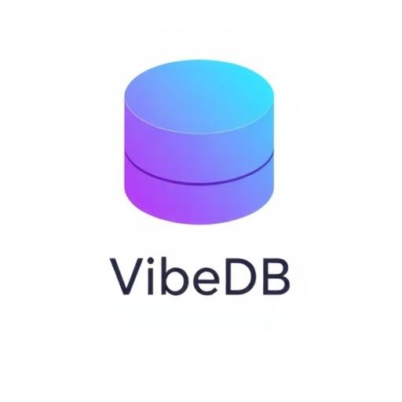
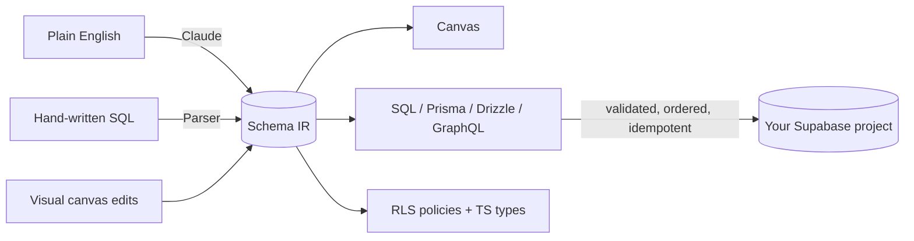

# Historical README — before the November roadmap publication

> Archived from [commit `46f2126`](https://github.com/zug11/Vibeclean/blob/46f21264cbf7486e4fa9d633a4ef70035380c034/README.md) when the new roadmap was published on 12 November 2026. The original wording is retained below; relative file links have been pointed at that frozen source snapshot.
>
> This document describes the earlier hosted product, including accounts, billing, and claims that have not been established by this documentation update. It is historical context, not the current roadmap, installation guide for the newer development checkout, or a release guarantee. Use the [current README](../../README.md), [implementation plan](../plans/IMPLEMENTATION_PLAN.md), and [focused Phase 1 plan](../plans/PHASE_1_SCHEMA_HISTORY_AND_IR_DDL.md) for the active local-first, BYOK direction.

---

<p align="center">
  
</p>

<h1 align="center">VibeDB</h1>

<p align="center">
  <strong>Speak it. See it. Ship it.</strong>
  <br />
  The AI-native database designer — from a sentence in plain English to a production Postgres schema, deployed, in under a minute.
</p>

<p align="center">
  
  
  
  
  
  
</p>

<p align="center">
  <a href="#the-vision">Vision</a> &bull;
  <a href="#features">Features</a> &bull;
  <a href="#how-it-works">How It Works</a> &bull;
  <a href="#getting-started">Get Started</a> &bull;
  <a href="#roadmap">Roadmap</a> &bull;
  <a href="#project-structure">Structure</a>
</p>

---

## The Vision

> **Every great product starts with a data model. Almost nobody enjoys building one.**

Schemas today are written in a 1970s text format, reviewed by squinting at diffs, and broken in production by a missing index nobody noticed. We think the database layer deserves what the frontend got a decade ago: a visual, intelligent, instantly-deployable design surface.

VibeDB is building toward a world where:

- **Natural language is the source format.** "A marketplace with vendors, listings, escrow payments and reviews" *is* the spec — the schema, constraints, indexes, and RLS policies follow from it.
- **The canvas is the single source of truth.** Visual design, hand-written SQL, and AI edits all converge on one intermediate representation that round-trips losslessly to SQL, Prisma, Drizzle, and GraphQL.
- **Mistakes are caught before they exist.** A static-analysis engine — think ESLint for your database — flags the missing primary key, the FK type mismatch, the btree index on jsonb, *while you design*, not at 2 a.m. during an incident.
- **Deploy is a button, rollback is a guarantee.** Versioned schemas, dependency-ordered idempotent DDL, and dry-run validation make shipping a schema as safe as shipping a commit.

The whiteboard era of database design is over.

---

## Features

### Visual Canvas Designer
Design your schema the way you think about it — spatially.

- **Infinite canvas** with pan, zoom, and drag-and-drop
- **Auto-layout** untangles your schema with one click
- **FK relationship lines** drawn as live bezier curves between the exact columns they connect
- **Full undo/redo** history (Ctrl+Z / Ctrl+Y)

### Complete Schema Modeling
Production-grade Postgres, not a toy diagram.

- **10+ column types** — `uuid`, `varchar`, `text`, `int`, `numeric`, `decimal`, `float`, `timestamp`, `boolean`, `jsonb`, custom enums
- **Constraints** — primary keys, not-null, unique, defaults
- **Foreign keys** — visual creation, status tracking, `DEFERRABLE` support
- **Indexes** — standard, unique, and partial indexes with `WHERE` clauses
- **Check constraints** — custom validation expressions
- **Enum types** — `CREATE TYPE` for categorical data
- **Functions & triggers** — `CREATE OR REPLACE FUNCTION` with `$$` block support

### AI That Builds, Not Just Suggests
Powered by **Anthropic Claude**, wired into every surface of the product.

| | Feature | What it does |
|---|---------|-------------|
| **Generate** | Schema Generation | Describe your app → a complete, normalized schema appears on the canvas |
| **Edit** | Batch Commands | "Add soft delete to all tables" — done in one command |
| **Suggest** | Smart Columns | AI recommends columns from your table's context |
| **Audit** | Schema Audit | A 0–100 quality score with a detailed rubric and one-click fixes |
| **Chat** | AI Assistant | Brainstorm, refine, and apply schema changes conversationally |
| **Query** | Query Generation | Describe what you want → get the SQL |
| **Seed** | Mock Data | Realistic INSERTs that respect FK order and relationships |

### Export Anywhere
One design, every serialization your stack needs.

- **SQL** — PostgreSQL DDL with tables, indexes, constraints, enums, and functions
- **Prisma** — complete schema with models, relations, and type mappings
- **Drizzle** — TypeScript ORM definitions ready to drop in
- **GraphQL** — type definitions for your API layer
- **CSV** — table and column metadata for documentation

### One-Click Deploy to Supabase
Design to production in seconds — safely.

- Connect with URL + service role key
- **Pre-deploy validation** catches issues before they touch your database
- **Smart FK ordering** — tables created in dependency order
- **Idempotent** — re-deploy without "already exists" errors
- **DEFERRABLE constraints** and **dollar-quote-aware** function deployment

### Schema Quality Tools
Ship with receipts.

- **AI Audit** — scoring rubric: −15 missing PKs, −5 missing indexes, −3 naming violations, and more
- **Deduplication** — one-click cleanup of duplicate indexes and columns
- **Linting** — automatic naming convention validation
- **Schema Diff** — snapshot and compare your schema over time
- **Auto-fix** — detect and resolve issues before deployment

### Project Management
Never lose work, never lose context.

- **Cloud save** to Supabase + **auto-save** every 3 seconds
- **Project browser** — search, create, and switch between schemas
- **SQL Import** — load existing DDL straight onto the canvas

---

## How It Works

Everything converges on one intermediate representation — the IR (`TableNode[]`). Whatever the input, the canvas, the exports, and the deploy pipeline always agree.



---

## Roadmap

The ambition: make VibeDB the most trustworthy way to design and ship a database. The current sprint (tracked in [CTO_SPRINT_GUIDE.md](https://github.com/zug11/Vibeclean/blob/46f21264cbf7486e4fa9d633a4ef70035380c034/CTO_SPRINT_GUIDE.md) and Jira) is laying the foundations.

**Now — the trust release**
- [ ] **Faithful compiler modes** — your SQL is *your* SQL: zero silent mutation on user-driven paths
- [ ] **AST-based SQL parser** — lossless import of UNIQUE, CHECK, partial indexes, and ON DELETE
- [ ] **Unified inline SQL editor** — CodeMirror-powered, two-way sync between SQL text and canvas
- [ ] **`analyzeSchema` diagnostics engine** — 20+ static-analysis rules (ESLint for Postgres) with risk-aware one-click fixes
- [ ] **Round-trip CI invariant** — import → export → re-import is provably lossless, enforced on every commit
- [ ] **Next-generation auto-layout** — layered graph placement with guaranteed zero node overlap and routed, de-spaghettified bezier edges

**Next**
- [ ] Schema migrations — diff two versions, generate `ALTER` scripts
- [ ] Per-table provenance — user-authored vs AI-generated vs imported, tracked forever
- [ ] Domain intelligence as opt-in suggestion packs (healthcare, fintech, marketplaces)
- [ ] Team workspaces — share, comment, and review schemas together

**Beyond**
- [ ] Live database sync — design against production, safely
- [ ] Multi-engine targets — MySQL, SQLite, PlanetScale, Neon
- [ ] Schema registry & versioned APIs — the data layer as a first-class artifact

---

## Tech Stack

| Layer | Technology |
|-------|------------|
| **Frontend** | React 18 + TypeScript |
| **Build** | Vite 5 (SWC) |
| **Styling** | Tailwind CSS 3 |
| **Components** | shadcn/ui (Radix UI) |
| **Animations** | Framer Motion |
| **Icons** | Lucide React |
| **Backend** | Supabase (Auth + Postgres + Edge Functions) |
| **AI** | Anthropic Claude API |
| **Payments** | Stripe |
| **Routing** | React Router v6 |
| **Server State** | TanStack React Query |

---

## Getting Started

### Prerequisites
- **Node.js** 18+
- A **Supabase** project ([supabase.com](https://supabase.com))
- **Supabase CLI** (`npm install -g supabase`)
- **Anthropic API key** for AI features ([console.anthropic.com](https://console.anthropic.com))

### 1. Clone & install
```bash
git clone https://github.com/zug11/Vibeclean.git
cd Vibeclean
npm install
```

### 2. Configure environment
```bash
cp .env.example .env
```

Fill in your Supabase credentials:
```env
VITE_SUPABASE_URL=https://your-project.supabase.co
VITE_SUPABASE_PUBLISHABLE_KEY=your-anon-public-key
```

### 3. Set up the database
```bash
supabase db push
```

This runs two migrations:
- `001_initial_schema.sql` — `profiles` and `schemas` tables with RLS policies
- `002_subscription_credits.sql` — subscription tier and credit columns

### 4. Deploy edge functions
```bash
supabase functions deploy
supabase secrets set ANTHROPIC_API_KEY=sk-ant-...
```

### 5. Start designing
```bash
npm run dev
```

Open **http://localhost:8080** — describe your app, and watch the schema build itself.

---

## Supabase Setup

### Database

| Table | Purpose |
|-------|---------|
| `profiles` | User profiles — display name, avatar, subscription tier, AI credits |
| `schemas` | Saved projects — name, JSONB schema definition, timestamps |

Both tables enforce **Row Level Security** — users can only read and write their own data.

### Auth
- **Google OAuth** — one-click sign-in
- **Email/Password** — traditional signup with email verification
- Auto-creates a profile on first login

### Edge Functions

| Function | Purpose |
|----------|---------|
| `vibedb-ai` | AI gateway — routes to Claude for schema generation, audit, chat, batch commands, mock data, queries |
| `vibedb-deploy` | Deploys SQL DDL to a target Supabase project |
| `check-subscription` | Returns subscription status and remaining credits |
| `create-checkout` | Creates Stripe checkout sessions |
| `buy-credits` | Processes credit top-up purchases |
| `customer-portal` | Opens Stripe customer portal |
| `stripe-webhook` | Handles Stripe webhook events |

### Secrets
```bash
supabase secrets set ANTHROPIC_API_KEY=sk-ant-...       # AI features
supabase secrets set STRIPE_SECRET_KEY=sk_...            # Payments
supabase secrets set STRIPE_WEBHOOK_SECRET=whsec_...     # Webhooks
```

---

## Project Structure

```
Vibeclean/
├── SPECIFICATION.md                  # Full repo specification (every file & folder)
├── CTO_SPRINT_GUIDE.md               # Sprint plan: SQL overhaul + canvas auto-layout
├── src/
│   ├── pages/
│   │   ├── LandingPage.tsx           # Marketing landing page
│   │   ├── AuthPage.tsx              # Login / signup
│   │   ├── VibeDBPage.tsx            # Main canvas editor (canvas, layout, AI handlers)
│   │   ├── PricingPage.tsx           # Subscription plans
│   │   └── NotFound.tsx              # 404
│   ├── components/
│   │   ├── vibedb/
│   │   │   ├── ExportGenerators.ts   # SQL, Prisma, Drizzle, GraphQL, CSV export
│   │   │   ├── AIChatPanel.tsx       # AI chat assistant
│   │   │   ├── AskDataPanel.tsx      # Natural-language data questions
│   │   │   ├── DatabaseManagerPanel.tsx # Live database management
│   │   │   ├── GenerationHistoryPanel.tsx # AI generation history
│   │   │   ├── MockDataModal.tsx     # Mock data generator
│   │   │   ├── QueryBuilderPanel.tsx # AI query generation
│   │   │   ├── SchemaAuditModal.tsx  # Audit scoring + suggestions
│   │   │   ├── SchemaCompareModal.tsx # Schema snapshot diff
│   │   │   ├── SQLViewerModal.tsx    # SQL preview
│   │   │   ├── SREModePanel.tsx      # SRE / observability mode
│   │   │   ├── SupabasePanel.tsx     # Supabase connection, RLS + TS types
│   │   │   └── VibeDBSidebar.tsx     # Table library sidebar
│   │   └── ui/                       # shadcn/ui component library
│   ├── lib/
│   │   ├── types.ts                  # The IR: TableNode, Column, DDLPatch, ...
│   │   ├── compiler-pass.ts          # 7-pass schema compiler
│   │   ├── project-storage.ts        # IndexedDB project persistence
│   │   ├── schema-diff.ts            # Schema diff (+ schema-diff.test.ts)
│   │   ├── supabase-integration.ts   # Target-project introspection
│   │   ├── database-connection.ts    # Direct DB connection helpers
│   │   ├── generation-*.ts           # AI strategies, history, progress tracking
│   │   ├── sre-types.ts              # SRE panel types
│   │   └── domains/                  # Domain rule modules (healthcare, finance, PE/VC)
│   ├── hooks/                        # Auth, mobile, toast hooks
│   ├── integrations/supabase/        # Supabase client + types
│   ├── App.tsx                       # Router + route guards
│   └── main.tsx                      # Entry point
├── supabase/
│   ├── migrations/                   # Database migrations
│   └── functions/                    # 7 edge functions (AI, deploy, Stripe, subscription)
└── public/                           # Static assets
```

For a complete description of every file, see [SPECIFICATION.md](https://github.com/zug11/Vibeclean/blob/46f21264cbf7486e4fa9d633a4ef70035380c034/SPECIFICATION.md). For the upcoming sprint plan, see [CTO_SPRINT_GUIDE.md](https://github.com/zug11/Vibeclean/blob/46f21264cbf7486e4fa9d633a4ef70035380c034/CTO_SPRINT_GUIDE.md).

---

## Scripts

| Command | Description |
|---------|-------------|
| `npm run dev` | Start dev server on port 8080 |
| `npm run build` | Production build |
| `npm run build:dev` | Development-mode build |
| `npm run preview` | Preview production build locally |
| `npm run lint` | Run ESLint |
| `npm test` | Run vitest suite once |
| `npm run test:watch` | Run vitest in watch mode |

---

## Environment Variables

| Variable | Location | Description |
|----------|----------|-------------|
| `VITE_SUPABASE_URL` | `.env` | Your Supabase project URL |
| `VITE_SUPABASE_PUBLISHABLE_KEY` | `.env` | Supabase anon/public key |
| `ANTHROPIC_API_KEY` | Supabase secrets | Anthropic API key for Claude |
| `STRIPE_SECRET_KEY` | Supabase secrets | Stripe secret key |
| `STRIPE_WEBHOOK_SECRET` | Supabase secrets | Stripe webhook signing secret |

---

## License

BSL

<p align="center">
  <sub>Built for everyone who has ever drawn a database on a napkin.</sub>
</p>

